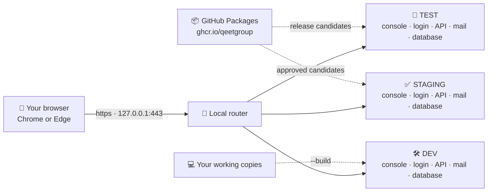
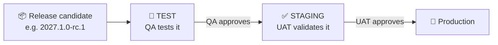

<div align="center">

# 🧪 Qeet ID Kit

**Run Qeet ID on your own computer with one terminal command: TEST for QA, STAGING for Product / UAT, DEV for
developers. No source code, no developer tools, just Docker.**

[](https://github.com/qeetgroup/qeet-id-kit/releases/latest)
[](#-what-you-need)
[](#-what-you-need)
[](#-what-you-need)
[](#-what-you-need)
[](#-your-addresses)

[📥 Download](#-download-the-kit) · [🚀 Quick start](#-quick-start) · [🌐 Addresses](#-your-addresses) ·
[🧰 Commands](#-everyday-commands) · [🩺 Troubleshooting](docs/troubleshooting.md) · [📝 Changelog](CHANGELOG.md)

</div>

## 📦 What's inside

Three complete copies of Qeet ID, each with its own server, hosted login, console, database and email inbox, at
real `https://` addresses such as <https://console.test.id.qeet.in>.

| Environment | Who uses it | What runs there | Start it (macOS) |
|:--|:--|:--|:--|
| 🧪 **TEST** | The **QA** team | The current release candidate | `bash macos/test/start.sh` |
| ✅ **STAGING** | The **Product / UAT** team | The candidate QA approved: the exact same build | `bash macos/staging/start.sh` |
| 🛠️ **DEV** | **Developers** | Images built from their own working copies | `bash macos/dev/start.sh --build` |

All three can run at the same time. Each has its own accounts, data, emails, passkeys and addresses, so nothing you
do in one appears in another.

> [!NOTE]
> These are **local** environments on your computer. They are not shared servers, and STAGING here is not a cloud
> staging environment: each tester has their own private copy.

## 🧭 How it works

Your browser talks to a small local router on `127.0.0.1`, which sends each address to the right environment.
TEST and STAGING download published Qeet ID images; DEV builds them from your code.



A candidate moves through the environments in one direction, and the same build is tested at every step:



| Part | What it is |
|:--|:--|
| 🖥️ **Console** | The Qeet ID admin console, where you start |
| 🔐 **Hosted login** | Sign-in, sign-up, consent and recovery pages |
| ⚙️ **API** | The Qeet ID server, with its production security settings on |
| 📬 **Mail inbox** | Catches every email Qeet ID sends; nothing reaches a real mailbox |
| 🗄️ **Database** | PostgreSQL, private to its environment and never exposed |

## ✅ What you need

| | Requirement |
|:--|:--|
| 🐳 **Docker** | macOS and Windows: [Docker Desktop](https://docs.docker.com/desktop/) ([Mac](https://docs.docker.com/desktop/setup/install/mac-install/) · [Windows](https://docs.docker.com/desktop/setup/install/windows-install/), keep the default *Linux containers* mode). Linux: [Docker Engine](https://docs.docker.com/engine/install/) with [Docker Compose](https://docs.docker.com/compose/install/linux/) 2.24 or newer |
| 🧠 **Memory** | At least **2 GiB** for Docker (Docker Desktop → Settings → Resources); **4 GiB** to run all three environments together |
| 💾 **Disk** | About **10 GiB** free |
| 💻 **System** | macOS (Apple Silicon or Intel), Windows 10/11 x64, or Linux (x64 or arm64) |
| 🌐 **Browser** | [Google Chrome](https://www.google.com/chrome/) or [Microsoft Edge](https://www.microsoft.com/edge). Other browsers have not been verified with the kit |
| 🐙 **GitHub** | A GitHub account your team lead has given access to the `qeetgroup` packages |

You do not need Git, Node.js, Go, a database client or any Docker commands.

## 📥 Download the kit

### 1. Download the ZIP

**[⬇️ Open the latest Qeet ID Kit release](https://github.com/qeetgroup/qeet-id-kit/releases/latest)**, sign in to
GitHub if asked, and under **Assets** download both files:

| File | What it is |
|:--|:--|
| `qeet-id-kit-vX.Y.Z.zip` | The kit itself (about 100 KB) |
| `qeet-id-kit-vX.Y.Z.zip.sha256` | Its checksum, to confirm the download is complete and unchanged |

Every earlier version is on the [releases page](https://github.com/qeetgroup/qeet-id-kit/releases).

> [!NOTE]
> **Which version?** Always the **Latest** release. The kit is numbered like Qeet ID, after the release it is made
> for: **Qeet ID Kit 2027.1.0** is the kit for Qeet ID 2027.1.0, and a kit fix during that release is 2027.1.1. The
> kit doesn't contain Qeet ID: it downloads the Qeet ID version under test (for example `2027.1.0-rc.2`) when you
> start an environment, so one kit runs every candidate and every later release. **Status** shows both versions. If
> a candidate ever needs a newer kit, Start says so and **Update Kit** installs it.

<details>
<summary>Prefer the terminal? Download with the GitHub CLI</summary>

If you have the [GitHub CLI](https://cli.github.com/) and have run `gh auth login`, this downloads both files of the
latest release into the current folder:

```bash
gh release download --repo qeetgroup/qeet-id-kit --pattern "qeet-id-kit-v*.zip*"
```

</details>

### 2. Check the download (recommended)

Open a terminal in the folder you downloaded to (usually `Downloads`) and run the line for your system, with your
version in place of `X.Y.Z`:

| System | Command | A good download shows |
|:--|:--|:--|
| macOS | `shasum -a 256 -c qeet-id-kit-vX.Y.Z.zip.sha256` | `qeet-id-kit-vX.Y.Z.zip: OK` |
| Linux | `sha256sum -c qeet-id-kit-vX.Y.Z.zip.sha256` | `qeet-id-kit-vX.Y.Z.zip: OK` |
| Windows (PowerShell) | `(Get-FileHash .\qeet-id-kit-vX.Y.Z.zip).Hash -eq (Get-Content .\qeet-id-kit-vX.Y.Z.zip.sha256).Split(' ')[0]` | `True` |

Anything else means the file is incomplete or was changed: delete it and download it again.

### 3. Extract it

Extract the ZIP in your home folder (for example `Documents`). It holds one folder, **`qeet-id-kit`**, and every
command in this guide is typed inside it.

- **macOS:** double-click the ZIP.
- **Windows:** right-click the ZIP → **Extract All…**. Windows adds a folder named after the ZIP, so the kit ends up
  in `qeet-id-kit-vX.Y.Z\qeet-id-kit`.
- **Linux:** `unzip qeet-id-kit-vX.Y.Z.zip`

> [!TIP]
> Avoid folders synced by OneDrive, iCloud Drive or Dropbox. You download the ZIP **once**: new Qeet ID candidates
> arrive through **Update**, and a newer kit through **Update Kit** ([everyday commands](#-everyday-commands)).

> [!NOTE]
> **Developers** working in the Qeet ID workspace can use their clone of this repository instead of the ZIP. Keep it
> next to `qeet-id-server`, `qeet-id-hosted` and `qeet-id-console`, which is where DEV's `--build` looks for them.

### 4. Open a terminal in the kit folder

- **macOS:** open Terminal, type `cd ` (with a space), drag the `qeet-id-kit` folder onto the window, press Enter.
- **Windows:** open the `qeet-id-kit` folder in File Explorer, right-click an empty area, choose **Open in Terminal**.
- **Linux:** `cd` to the `qeet-id-kit` folder.

> [!NOTE]
> **Windows:** the commands work in PowerShell and in Command Prompt. In Command Prompt, leave out the leading `.\`
> (for example `windows\test\start.cmd`).

## 🔑 Sign in to GitHub Packages (once)

Qeet ID's images live in GitHub Packages, so Docker needs to sign in once.

1. **Create a token.** Use this link, which opens GitHub's form with the right scope already ticked:
   **[Create a classic token with `read:packages`](https://github.com/settings/tokens/new?scopes=read:packages&description=Qeet%20ID%20Kit)**.
   Pick an expiry, keep **only** `read:packages` ticked, choose **Generate token** and copy it.
   It must be a **classic** token: fine-grained tokens do not work with GitHub Packages.
2. **Run Login** and enter your GitHub username, then paste the token when Docker asks (typing is hidden):

   | macOS | Linux | Windows |
   |:--|:--|:--|
   | `bash macos/tools/login.sh` | `bash linux/tools/login.sh` | `.\windows\tools\login.cmd` |

Docker keeps the token in its own credential store; the kit never stores it. Login then checks that your sign-in can
download every Qeet ID image, and tells you if it cannot (usually: ask your team lead for package access).

## 🚀 Quick start

| | macOS | Linux | Windows |
|:--|:--|:--|:--|
| 🧪 QA: start TEST | `bash macos/test/start.sh` | `bash linux/test/start.sh` | `.\windows\test\start.cmd` |
| ✅ UAT: start STAGING | `bash macos/staging/start.sh` | `bash linux/staging/start.sh` | `.\windows\staging\start.cmd` |
| 🛠️ Developers: start DEV | `bash macos/dev/start.sh --build` | `bash linux/dev/start.sh --build` | `.\windows\dev\start.cmd --build` |

The first start downloads Qeet ID (about 1 GB) and prepares a fresh database, which takes about a minute after the
download. Then your browser opens the console:

```text
Qeet ID TEST

Installed: none
Available: 2027.1.0-rc.1
Updating...
✓ Generated local test-only secrets
✓ Images ready
Starting TEST (first start applies every database migration — about a minute)...
✓ Database ready, migrations completed
✓ Qeet ID Server healthy
✓ Login healthy
✓ Console healthy
✓ Mail inbox healthy
✓ Fresh environment: empty baseline — create accounts through Sign up

✓ Qeet ID 2027.1.0-rc.1 is ready in TEST.
```

> [!IMPORTANT]
> **The first start asks you once to trust the kit's certificate authority**, so your browser accepts the
> `https://` addresses: macOS asks for your password, Windows asks you to choose **Yes**. It is created on your
> computer, serves TEST, STAGING and DEV alike, and can vouch only for the kit's own addresses
> ([security](#-security)).

STAGING runs a candidate only after QA has approved it in TEST and it has been promoted. Until then, Start STAGING
says *No Qeet ID candidate has been promoted to STAGING yet*. DEV is described in
[For developers: DEV](#-for-developers-dev).

## 🌐 Your addresses

| | 🧪 TEST | ✅ STAGING | 🛠️ DEV |
|:--|:--|:--|:--|
| 🖥️ **Console** (start here) | <https://console.test.id.qeet.in> | <https://console.staging.id.qeet.in> | <https://console.dev.id.qeet.in> |
| 🔐 **Hosted login** | <https://login.test.id.qeet.in> | <https://login.staging.id.qeet.in> | <https://login.dev.id.qeet.in> |
| ⚙️ **API** | <https://api.test.id.qeet.in> | <https://api.staging.id.qeet.in> | <https://api.dev.id.qeet.in> |
| 📬 **Mail inbox** | <https://mail.test.id.qeet.in> | <https://mail.staging.id.qeet.in> | <https://mail.dev.id.qeet.in> |

These links work only while that environment is running on your computer. The bare address (for example
<https://test.id.qeet.in>) opens the console, and `http://` redirects to `https://`. The website
(<https://id.qeet.in>) and the docs (<https://docs.id.qeet.in>) are not part of the kit.

Every address is a real public name whose DNS points at your own computer (`127.0.0.1`), so Google and Microsoft
sign-in can be tested in every environment. Each person reaches their own computer; nothing goes to the internet.
If the addresses do not open, your network may block such names: Start then shows a line to add to your hosts file
([troubleshooting](docs/troubleshooting.md#in-the-browser)).

## 🧪 Test data: you start empty

Every environment starts with **no accounts and no organizations**. Create what you need the way a customer would:
**Sign up** in the console, verify your email, create your organization, invite teammates.

Every email Qeet ID sends (verification codes, magic links, invitations, password resets) lands in that environment's
**Mail inbox**, not in a real mailbox. Use any address you like, such as `ana@example.test`.

## 🧰 Everyday commands

The TEST commands are shown. For STAGING, use `staging` instead of `test` (for example
`bash macos/staging/update.sh`). On Linux, use `linux/` instead of `macos/`.

| To… | macOS / Linux | Windows |
|:--|:--|:--|
| ⬆️ Get the newest candidate (after a fix) | `bash macos/test/update.sh`, or start again | `.\windows\test\update.cmd` |
| 📊 See versions, health and addresses | `bash macos/test/status.sh` | `.\windows\test\status.cmd` |
| ⏸️ Stop one environment (data kept) | `bash macos/test/stop.sh` | `.\windows\test\stop.cmd` |
| ⏹️ Stop everything (data kept) | `bash macos/tools/stop-all.sh` | `.\windows\tools\stop-all.cmd` |
| ↩️ Go back to the previous candidate | `bash macos/test/rollback.sh` | `.\windows\test\rollback.cmd` |
| 🧽 Start over with empty data | `bash macos/test/reset.sh` | `.\windows\test\reset.cmd` |
| 📜 See logs for a bug report | `bash macos/test/logs.sh server` | `.\windows\test\logs.cmd server` |
| 🩺 Check your computer | `bash macos/tools/doctor.sh` | `.\windows\tools\doctor.cmd` |
| 🗑️ Free disk space (old candidates) | `bash macos/tools/cleanup.sh` | `.\windows\tools\cleanup.cmd` |
| 📦 Install a newer kit | `bash macos/tools/update-kit.sh` | `.\windows\tools\update-kit.cmd` |

Logs takes `server`, `login`, `console`, `db`, `mail` or `edge`, plus `--follow` to keep watching and `--tail N` for
the last N lines. Any command explains its options with `--help`.

<details>
<summary>⬆️ <b>Update</b>: get a fixed candidate</summary>

When developers fix a bug, a new candidate is published (for example `2027.1.0-rc.1 → rc.2`). Run **Update**, or just
start the environment again. Your data is kept; only what changed is restarted:

```text
Installed: 2027.1.0-rc.1
Available: 2027.1.0-rc.2
Updating...
✓ Qeet ID 2027.1.0-rc.2 is ready in TEST.
```

STAGING receives a candidate only after QA approves it, so TEST and STAGING can be on different candidates. You
never download a new ZIP for a new candidate.

</details>

<details>
<summary>↩️ <b>Rollback</b>: go back one candidate</summary>

Rollback returns to the previous candidate already on your computer, without downloading, and stays there until you
run Update. If your data was already upgraded beyond what the older candidate understands, it refuses and tells you
how to roll back with fresh data (`rollback.sh --reset`, which deletes that environment's data).

</details>

<details>
<summary>🧽 <b>Reset</b>: start one environment fresh</summary>

Reset permanently deletes one environment's accounts, organizations and emails and starts it fresh. It asks you to
type the environment's name (`test`, `staging` or `dev`) first and never touches the other environments. Afterwards,
also delete any passkeys you saved for it (for example `test.id.qeet.in`) in your browser or password manager.

</details>

<details>
<summary>📦 <b>Update Kit</b>: install a newer kit</summary>

A new kit is needed only when the kit itself changes; when a candidate needs one, Start tells you. **Update Kit**
installs it in a new folder next to this one (`qeet-id-kit-X.Y.Z`) and copies your `environments/optional.env` into
it. Use the new folder from then on. Your data and GitHub sign-in are kept. What changed in each kit version is in the
[changelog](CHANGELOG.md).

</details>

<details>
<summary>🩺 <b>Doctor</b>: when something is wrong</summary>

Run **Doctor** first. It checks Docker, memory, disk, ports 80 and 443, your GitHub sign-in (including that it can
download every image), that the addresses lead to your computer, that the certificate authority is trusted, and the
kit itself, and says what to fix. Every message the kit shows is explained in
[troubleshooting](docs/troubleshooting.md).

</details>

## 🐞 Reporting a bug

Include:

- the **environment** (TEST, STAGING or DEV) and the **candidate** shown by **Status** (for example `2027.1.0-rc.1`);
- the **time** it happened and the **request ID** from the error, if one is shown;
- the **Logs** output, if it helps.

Never paste passwords, tokens or cookie values into an issue or a chat.

## 💻 For developers: DEV

DEV runs Qeet ID exactly like TEST and STAGING (behind the local router, with every production security setting on),
but from **your own code** instead of a release candidate.

| To… | macOS / Linux | Windows |
|:--|:--|:--|
| 🔨 Build all three components from your working copies and start | `bash macos/dev/start.sh --build` | `.\windows\dev\start.cmd --build` |
| 🏷️ Use a specific image for one component | add `--image server=<image>` (or `login=`, `console=`) | same |
| ▶️ Start again with the images DEV ran last time | `bash macos/dev/start.sh` | `.\windows\dev\start.cmd` |
| 🌱 Replace DEV's data with the demo data (asks first) | `bash macos/dev/seed.sh` | `.\windows\dev\seed.cmd` |

- **Where the code comes from.** `--build` uses the repositories next to the kit folder: `../qeet-id-server`,
  `../qeet-id-hosted` (the login) and `../qeet-id-console`. Elsewhere, set `QEET_KIT_DEV_<COMPONENT>_SRC` in
  `environments/optional.env`. Each repository is built with its own `Dockerfile`; your working copy is only read.
- **The server checkout must accept DEV's `https://*.dev.id.qeet.in` addresses** (`qeet-id-server` `develop` from
  21 Oct 2026 on). An older one refuses to start with *APP_BASE_URL must use localhost…*.
- **`--image` wins over `--build`** for that component, so
  `start.sh --build --image login=<image> --image console=<image>` builds only the server. Published images look
  like `ghcr.io/qeetgroup/qeet-id-server:sha-<commit>`.
- **Status** shows each component's image and commit (`-dirty` when the working copy had uncommitted changes). The
  first build of all three components takes several minutes.
- **Seed** fills a running DEV with the server's demo data: Qeet Group and its customers on every plan, their people
  and roles, Qeet Group's products as applications, single sign-on, social sign-in, access requests, webhooks and
  months of sign-in and audit history. It ends by listing the test accounts and what each one shows. It
  **replaces** everything in DEV (keeping its keys and Mail inbox), so it asks first (`--yes` skips the question). It
  needs a server image built with `--build` from a `qeet-id-server` checkout that has the seed (`develop` from
  12 Nov 2026 on). TEST and STAGING have no Seed: testers create their own data through the product.
- DEV has no Update or Rollback: rebuild with `--build`. If you check out an older branch whose database is older
  than DEV's data, Start refuses and tells you to **Reset** DEV.

## 🔧 Optional settings

Nothing needs configuring: sign-up, email, passkeys, sign-in, organizations and OIDC work as shipped. To switch on a
third-party integration, fill in the values in `environments/optional.env` and start the environment again. The file
explains every setting, and applies to every environment alike.

| Integration | Needs |
|:--|:--|
| 🔑 GitHub, Google or Microsoft sign-in | A test app registered for each environment's `https://api.<env>.id.qeet.in/v1/social/<provider>/callback` |
| 💳 Razorpay payments | Razorpay **test mode** keys; works without a webhook |
| 📱 SMS codes | A Twilio account (real, paid SMS) |
| 🤖 The AI assistant | A test or development key for its provider |

- **Test credentials only.** Never put a production key, password or token there.
- Security settings and the keys the kit generates cannot be changed there.

## 🚫 What you can't test locally

These need public callbacks, a phone or paid third-party accounts:

| Feature | Why, and what works instead |
|:--|:--|
| 🍎 **Apple sign-in** | Not verified yet: Apple may ask to verify the domain from the internet. Google, Microsoft and GitHub sign-in work |
| 💳 **Stripe payments** | Stripe confirms payments only by webhook, which must reach your computer. Razorpay test payments work, and the Free plan always works |
| 📱 **SMS codes** | Only with a Twilio account in `environments/optional.env`. Use email or authenticator-app MFA instead |
| 🔔 **Webhooks, SIEM streaming, auth hooks** to a receiver on your computer | Qeet ID blocks private and `*.localhost` destinations by design; a public HTTPS test receiver works |
| 👥 **SCIM from a cloud identity provider** (Okta, Entra) | Their servers cannot reach your computer. SAML sign-in works: the browser carries it |
| 🌍 **IP allow-lists and country rules** | Every request reaches Qeet ID from Docker's own address |
| 📲 **Qeet ID on Android and iPhone** | The apps run on a phone, and the kit's addresses lead only to this computer. They are tested separately |
| 🔗 **Third-party apps (OIDC)** with redirects other than `http://localhost:<port>/…` | Other `http` redirect hosts are rejected, as in production |

## 🔒 Security

- Everything runs on your computer and listens only on `127.0.0.1`. It is not reachable from the network.
- No production data, accounts or secrets are used. Each environment generates its own random, test-only keys the
  first time it starts and keeps them in your user folder (`~/.qeet-id-test-kit` on macOS/Linux,
  `%LOCALAPPDATA%\QeetIdTestKit` on Windows), never in the kit folder or the ZIP. Reset deletes them with the data.
- Qeet ID runs with its **production security settings** (CSRF protection, secure cookies, strict outbound rules);
  only the addresses differ.
- The `https` certificates come from a **certificate authority created on your computer** the first time the kit
  starts (`edge/ca` in the state folder). It is name-constrained: it can vouch only for the kit's own zones
  (`*.test.id.qeet.in`, `*.staging.id.qeet.in`, `*.dev.id.qeet.in`), never for any other site, production
  `id.qeet.in` included. Its key never leaves the state folder, and Reset keeps it.

## 🧹 Uninstall

1. **Stop everything**: `bash macos/tools/stop-all.sh` (Windows: `.\windows\tools\stop-all.cmd`).
2. **Reset** each environment you used, or delete every kit volume and network at once:

   ```text
   docker volume rm qeet-id-test-postgres qeet-id-test-mail qeet-id-staging-postgres qeet-id-staging-mail qeet-id-dev-postgres qeet-id-dev-mail
   docker network rm qeet-id-dev-edge qeet-id-test-edge qeet-id-staging-edge
   ```

3. Run **Cleanup**, then delete any remaining `qeet-id-*` images in Docker Desktop (including DEV's `qeet-id-*:dev`
   builds).
4. Delete the state folder (`~/.qeet-id-test-kit` or `%LOCALAPPDATA%\QeetIdTestKit`) and the kit folder, and remove
   the trusted *Qeet ID Kit local CA (this computer only)* certificate:
   - macOS: Keychain Access → login → Certificates;
   - Windows: `certmgr.msc` → Trusted Root Certification Authorities;
   - Linux: `certutil -d sql:$HOME/.pki/nssdb -D -n "Qeet ID Kit local CA (this computer only)"`.
5. Optionally sign out: `docker logout ghcr.io`.

## 🧩 Related repositories

| Repository | What it is |
|:--|:--|
| [`qeet-id-server`](https://github.com/qeetgroup/qeet-id-server) | The Qeet ID platform and its API |
| [`qeet-id-hosted`](https://github.com/qeetgroup/qeet-id-hosted) | The hosted login: sign-in, sign-up, consent and recovery |
| [`qeet-id-console`](https://github.com/qeetgroup/qeet-id-console) | The admin console |

**Maintainers:** how the kit works and how releases move are in this repository's `docs/` (not part of the ZIP):
[architecture](https://github.com/qeetgroup/qeet-id-kit/blob/main/docs/architecture.md) ·
[release process](https://github.com/qeetgroup/qeet-id-kit/blob/main/docs/release-process.md) ·
[application contract](https://github.com/qeetgroup/qeet-id-kit/blob/main/docs/application-contract.md).
To release the kit, update `VERSION` (`YEAR.MONTH.N`) and `CHANGELOG.md` on `develop` and merge `develop` into
`main`: that tags `vYEAR.MONTH.N` and publishes the ZIP, its checksum and the image **Update Kit** installs.
